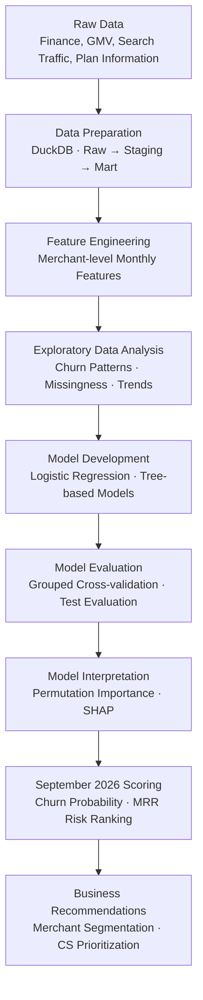

# Shopify Merchant Churn Prediction

An end-to-end machine learning project that predicts merchant churn, identifies at-risk Shopify merchants, and helps Customer Success teams prioritize retention efforts.

## 1. Project Overview

Merchant churn is a major challenge for subscription-based SaaS businesses. Identifying merchants who are likely to leave allows CS teams to intervene earlier, allocate resources more effectively, and protect recurring revenue.

This project develops a machine learning pipeline to predict whether an **active, paying Shopify merchant will churn within the next 30 days**. Beyond generating churn probabilities, it ranks merchants by risk and estimates their potential Monthly Recurring Revenue (MRR) exposure to support actionable retention decisions.

**Key objectives:**
- Identify merchants with a high probability of churning.
- Understand behavioral and financial patterns associated with churn.
- Rank at-risk merchants to support targeted CS outreach.
- Estimate potential MRR exposure to inform resource allocation.

## 2. End-to-End Workflow

The project follows a reproducible workflow, from raw data preparation to merchant-level churn scoring.

### Project Phases

| Phase | Key Activities |
|---|---|
| **1. Data Preparation** | Set up the DuckDB environment, ingest raw datasets, and organize data into Raw, Staging, and Mart layers. |
| **2. Dataset Construction** | Define churn eligibility and labels, build merchant-month features, and validate the training and scoring datasets. |
| **3. Exploratory Data Analysis & Modeling** | Analyze churn patterns, engineer predictive features, train multiple models, and tune the final model. |
| **4. Evaluation & Business Application** | Evaluate predictive performance, interpret model behavior, score September merchants, and develop retention recommendations. |

## 3. Data & Methodology

### Data Sources

The project integrates four datasets:

- **Finance data:** Merchant-level MRR, tenure, and financial information.
- **GMV data:** Monthly Gross Merchandise Value, reflecting merchant sales activity.
- **Search traffic data:** Search volume, product clicks, add-to-carts, orders, and sales.
- **Plan information:** Subscription plan attributes and related merchant information.

The source data covers monthly observations from **March to September 2026**, with finance snapshots available from **June to September 2026**.

### Target Definition

The prediction target is `churn_next_30d`, indicating whether an eligible merchant churns within the following 30-day period.

- **Prediction unit:** One merchant at one monthly snapshot.
- **Eligibility:** Active, paying merchants at the snapshot date.
- **Training period:** June and July 2026.
- **Test period:** August 2026.
- **Scoring period:** September 2026.

The September dataset contains active merchants whose churn outcomes are not yet available, making it suitable for prospective scoring.

### Feature Engineering

Features are constructed at the merchant-month level and cover several dimensions:

| Feature Group | Examples |
|---|---|
| Financial | Beginning MRR, ending MRR, MRR changes |
| Merchant Lifecycle | Tenure in months |
| Sales Activity | GMV over 30/60-day windows and growth rates |
| Search Engagement | Search volume and growth rates |
| Conversion Behavior | Product clicks, search clicks, add-to-carts, orders |
| Data Availability | Indicators for missing GMV and search data |

Feature engineering also includes rolling-window metrics, growth rates, missing-value indicators, and transformations for skewed variables.

### Modeling Approach

Multiple models are evaluated, including:

- Dummy Classifier as a baseline.
- Logistic Regression as an interpretable linear benchmark.
- HistGradientBoosting as a tree-based model.

To address repeated monthly observations from the same merchants, model validation uses **StratifiedGroupKFold**, grouping observations by merchant (`shop_key`).

Given the low churn prevalence, the project also evaluates class-imbalance handling and uses a probability threshold selected from out-of-fold training predictions to identify at-risk merchants.

## 4. Model Performance

The final model is a tuned **HistGradientBoosting classifier**.

### Test Set Performance

| Model | ROC-AUC | PR-AUC |
|---|---:|---:|
| Dummy Classifier | 0.5000 | 0.0245 |
| Logistic Regression | 0.6977 | 0.0665 |
| **Tuned HistGradientBoosting** | **0.7371** | **0.0817** |

The test set contains 8,375 merchant-month observations, with 205 churn cases (a churn prevalence of approximately 2.45%).

The final model improves both ranking ability and precision-recall performance compared with the baseline and Logistic Regression.

### Top-K Merchant Prioritization

Rather than relying only on a fixed classification threshold, the model ranks merchants by predicted churn probability. This allows CS teams to focus on a manageable portion of the merchant population.

| Contact Group | Merchants Contacted | Churn Captured | Precision | Recall | Lift |
|---|---:|---:|---:|---:|---:|
| Top 5% | 419 | 52 | 12.41% | 25.37% | 5.07x |
| Top 10% | 838 | 70 | 8.35% | 34.15% | 3.41x |

**Business interpretation:** Contacting the top 5% highest-risk merchants captures approximately 25% of actual churn cases in the test set, at a churn rate more than five times the population baseline.

## 5. Model Interpretation & Key Insights

Permutation importance and SHAP analysis highlight the behavioral and financial signals that contribute most to churn predictions.

Key findings include:

1. **Declining search activity matters:** Search growth over 60 days is the most important feature in permutation importance analysis.
2. **Declining sales activity is informative:** GMV growth over 30 days is another prominent predictor.
3. **Merchant lifecycle matters:** Tenure contributes to churn predictions, suggesting that churn patterns differ across merchant lifecycle stages.
4. **Missing behavioral data matters:** The availability of GMV and search data is associated with model predictions and should be considered when interpreting risk scores.

Error analysis also shows that some long-tenured merchants with relatively strong historical activity are harder to identify as churn cases. The model may therefore miss merchants whose churn is not preceded by a clear decline in observable activity.

These findings represent predictive associations, not causal relationships.

## 6. September 2026 Scoring & Business Impact

After model selection and test evaluation, the final model is applied to **8,227 eligible merchants** in September 2026.

### Scoring Results

| Metric | Result |
|---|---:|
| Merchants Scored | 8,227 |
| Merchants Flagged at the 4% Threshold | 5,783 |
| Share Flagged as At-Risk | 70.29% |
| Total Current EOM MRR | 688,737.89 |
| Total Expected MRR at Risk | 77,329.49 |
| Expected MRR at Risk / Current EOM MRR | 11.23% |

Expected MRR at Risk is calculated at merchant level:

`Expected MRR at Risk = Predicted Churn Probability × EOM MRR`

This metric combines churn likelihood with merchant revenue exposure, allowing prioritization to account for both risk and financial value.

### Revenue-Based Prioritization

Ranking merchants by Expected MRR at Risk concentrates potential revenue exposure among a relatively small group.

| Priority Group | Merchants | Expected MRR at Risk | Share of Total Expected MRR at Risk |
|---|---:|---:|---:|
| Top 5% | 412 | 35,437.31 | 45.83% |
| Top 10% | 823 | 47,657.80 | 61.63% |
| Top 20% | 1,646 | 60,386.17 | 78.09% |

The results suggest that CS teams can prioritize a smaller group of merchants with the greatest estimated revenue exposure before expanding outreach to the broader at-risk population.

### Recommended CS Actions

| Merchant Segment | Recommended Action |
|---|---|
| High Risk – High Value | Personalized, high-touch outreach; investigate account health and address potential blockers. |
| Low Risk – High Value | Proactive relationship management and regular account health checks. |
| High Risk – Low Value | Scalable retention campaigns, product education, and troubleshooting support. |
| Low Risk – Low Value | Automated engagement and self-service resources. |

The exported merchant ranking provides churn probability, MRR exposure, ranking, and priority information to support these actions.

## 7. Key Deliverables

| Deliverable | Description |
|---|---|
| `models/final_churn_model.pkl` | Saved final machine learning model. |
| `models/final_churn_model_metadata.json` | Model metadata, including features and prediction threshold. |
| `outputs/merchant_churn_ranking_2026_09.csv` | September merchant ranking by predicted churn probability and MRR risk. |
| `outputs/at_risk_merchants_2026_09.csv` | Filtered list of at-risk merchants for CS prioritization. |
| `docs/assumptions_log.md` | Documentation of data and modeling assumptions. |
| `notebooks/02_eda.ipynb` | Exploratory data analysis and modeling workflow. |

## 8. Limitations

- **Limited historical coverage:** The available finance snapshots cover only four months, restricting the amount of historical churn behavior available for model development.
- **Class imbalance:** Churn cases account for only approximately 2.45% of the test population, making reliable identification of churners challenging.
- **Incomplete behavioral data:** GMV and search activity are not available for every merchant, which may affect both feature quality and prediction reliability.
- **Predictions are not causal:** A high churn probability does not establish why a merchant may churn or guarantee that an intervention will prevent it.
- **No measured intervention outcomes:** Expected MRR at Risk represents modeled exposure, not revenue that can necessarily be recovered through retention activities.

The model should therefore be used as a **decision-support tool** for prioritizing CS resources, rather than as a deterministic churn decision system.

## 9. Technology Stack

- **Programming:** Python
- **Data Processing & Analytics:** DuckDB, SQL, Pandas, NumPy
- **Machine Learning:** Scikit-learn
- **Model Interpretation:** SHAP, Permutation Importance
- **Visualization:** Matplotlib, Seaborn
- **Development Environment:** Jupyter Notebook, VS Code
- **Version Control:** Git, GitHub
